<a href="https://methuos.pages.dev">
  
</a>

<div align="center">

<a href="https://methuos.pages.dev"></a>
<a href="mailto:methuos@proton.me"></a>

</div>


### `01 — SELECTED WORK` / three connected worlds

> Every artifact is a tool I am building. Follow one inside.

| | Project | What it is |
|:--|:--|:--|
| `01` | **[Canopy](https://methuos.pages.dev/projects/canopy/)** <br><sub>`SPATIAL PROJECT EXPLORER`</sub> | Project structure, grown into a tree you can walk through. |
| `02` | **[Cliptera](https://methuos.pages.dev/projects/cliptera/)** <br><sub>`LIVE VIDEO & CLIPPING`</sub> | A timeline, a playhead, and the one moment worth keeping. |
| `03` | **[Lens](https://methuos.pages.dev/projects/lens/)** <br><sub>`SOURCE TREE INVENTORY`</sub> | An offline inventory of any source tree, from the command line. |


### `02 — HUMAN FILE`

**A builder. Always curious.**

I am Methuos, an independent developer based in Iraq. I build desktop software and command-line tools, with Rust and Linux at the center of my work.

```text
BASED IN   IRAQ
BUILDS     DESKTOP SOFTWARE / CLI TOOLS
CORE       RUST · LINUX · SLINT · OPEN SOURCE
RUNS ON    ARCH LINUX + HYPRLAND
```


### `03 — BUILD LOG` / project chapters

> Chapters, not a timeline — each one is a tool still being shaped.

```text
CHAPTER 01   LENS       Understand a project. Explore its source tree.
CHAPTER 02   CLIPTERA   Find the moment. Make the clip.
CHAPTER 03   CANOPY     Turn project structure into something visible.
```


### `04 — STACK`


### `05 — THE LAB` / useful. useless. interesting.

Small experiments that live only on the website — **[Field Study](https://methuos.pages.dev/#lab)**, **[Signal / Noise](https://methuos.pages.dev/#lab)**, and **[Structure](https://methuos.pages.dev/#lab)**.


### `06 — SIGNAL`

<div align="center">


</div>


<div align="center">


An idea, a collaboration, or just a curious hello.

**[METHUOS.PAGES.DEV ↗](https://methuos.pages.dev)** &nbsp;·&nbsp; **[METHUOS@PROTON.ME →](mailto:methuos@proton.me)**

<sub><code>METHUOS.OS / INDEPENDENT BUILDER / IRAQ</code></sub>

</div>
